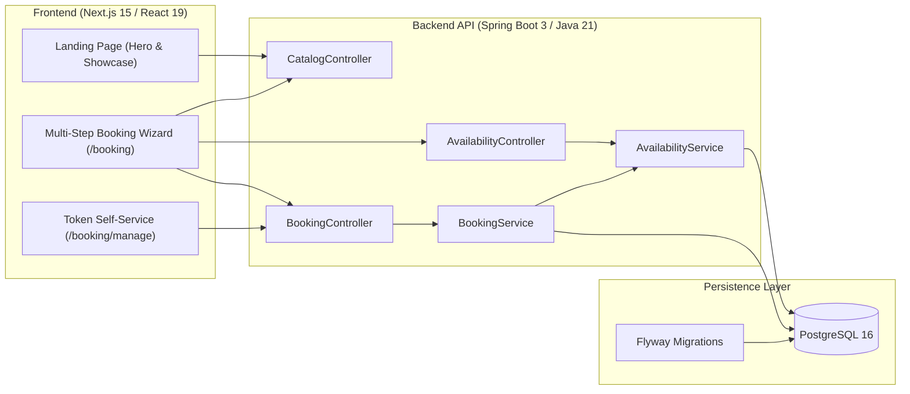

# Velvet Salon

[](https://github.com/Sankalpa-KMCP/salon_full_stack/actions)


**Velvet Salon** is a full-stack appointment booking and salon management platform. It combines a client-facing booking application with a Java 21 / Spring Boot 3 REST API and a PostgreSQL database.

Customers can browse treatments, view stylist schedules in real time, book appointments without account friction, and manage or cancel bookings using an issued cancellation token.

---

## Key Features

- **Interactive Booking Flow:** Multi-step wizard to select treatments, pick preferred stylists, browse available dates, and reserve time slots.
- **Real-Time Availability Engine:** Dynamic slot calculation (`AvailabilityService`) that cross-checks stylist working hours, scheduled breaks, service durations, and existing reservations.
- **Conflict & Double-Booking Prevention:** Backend validation guards against overlapping bookings (`DoubleBookingException`) and verifies stylist qualifications (`UnqualifiedStylistException`).
- **Frictionless Self-Service Management:** Customers receive a secure cancellation token upon booking, allowing them to look up or cancel appointments on `/booking/manage` without creating an account.
- **Automated Schema Migrations:** Production-ready database version control using **Flyway**, with automated schema generation and seed fixtures (`SeedDataConfig`).
- **Containerized Local Stack:** Ready-to-run `docker-compose.yml` for local PostgreSQL orchestration.
- **Comprehensive Integration Testing:** Full-stack test suite covering JPA repositories, domain services, web controllers, and Next.js frontend builds.

---

## Architecture Overview



---

## Tech Stack

| Layer | Technology | Details |
|---|---|---|
| **Frontend** | Next.js 15, React 19, TypeScript | App Router, Tailwind CSS, Lucide Icons |
| **Backend** | Spring Boot 3.4, Java 21 | Spring Data JPA, Spring Validation, Actuator |
| **Database** | PostgreSQL 16 | Flyway migration runner, HikariCP pool |
| **Build & Tooling** | Maven & npm | Docker multi-stage builds, Docker Compose |
| **CI/CD** | GitHub Actions | Automated build, test, and lint workflow |

---

## API Reference

The backend exposes clean REST endpoints:

| Method | Endpoint | Description |
|---|---|---|
| `GET` | `/actuator/health` | Healthcheck and service status |
| `GET` | `/api/catalog/services` | Retrieve all active salon services, categories, prices, and durations |
| `GET` | `/api/catalog/staff` | Retrieve all active stylists and their specialties |
| `GET` | `/api/booking/availability` | Query available time slots for a specific date, stylist, and service |
| `POST` | `/api/booking` | Create an appointment; returns booking details and `cancellationToken` |
| `GET` | `/api/booking/{token}` | Lookup an appointment by cancellation token |
| `DELETE` | `/api/booking/{token}` | Cancel an appointment by cancellation token |

---

## Local Development Quickstart

### Prerequisites
- **Java 21+** (JDK)
- **Node.js 20+** and **npm**
- **Docker & Docker Compose** (for local PostgreSQL)

---

### 1. Clone the Repository
```bash
git clone https://github.com/Sankalpa-KMCP/salon_full_stack.git
cd salon_full_stack
```

### 2. Start PostgreSQL
```bash
docker compose up -d
```
*This starts a local PostgreSQL container mapped to port `5432` with database `velvet_salon`.*

---

### 3. Run the Backend API
```bash
cd backend
./mvnw spring-boot:run
```
*(On Windows PowerShell, use `.\mvnw.cmd spring-boot:run`)*

The API will start on **`http://localhost:8080`**. Flyway automatically executes database migrations on startup.

---

### 4. Run the Frontend
In a new terminal:
```bash
cd frontend
npm install
npm run dev
```
Open **`http://localhost:3000`** in your browser.

---

## Running Tests

### Backend Tests (Spring Boot + JUnit 5)
```bash
cd backend
./mvnw test
```
*Runs all unit and integration tests including repository queries, availability algorithms, and MockMvc controller checks.*

### Frontend Checks
```bash
cd frontend
npm run lint
npm run build
```

---

## Monorepo Project Structure

```text
salon_full_stack/
├── .github/workflows/
│   └── ci.yml               # Automated build & test pipeline
├── backend/
│   ├── src/main/java/com/velvetsalon/api/
│   │   ├── config/          # CORS, Flyway, Seed data config
│   │   ├── domain/          # Entities & services (Appointment, Booking, Service, Staff)
│   │   └── web/             # REST controllers & DTOs
│   ├── src/main/resources/  # application.yml & Flyway SQL migrations
│   ├── src/test/            # Comprehensive integration tests
│   ├── Dockerfile           # Multi-stage production container build
│   └── pom.xml              # Maven dependencies
├── frontend/
│   ├── app/
│   │   ├── booking/         # Booking wizard & self-service management
│   │   ├── services/        # Service catalogue
│   │   ├── team/            # Stylist profiles
│   │   └── page.tsx         # Showcase landing page
│   ├── components/          # Reusable UI components
│   └── package.json
└── docker-compose.yml       # Local PostgreSQL service
```

---

## Author

**Sankalpa K M C P**  
*IT Undergraduate @ SLIIT*  
- **GitHub:** [@Sankalpa-KMCP](https://github.com/Sankalpa-KMCP)  
- **LinkedIn:** [Sankalpa KMCP](https://www.linkedin.com/in/sankalpa-k-m-c-p-2a900b3ba/)

---

## License

This project is open-source and available under the [MIT License](LICENSE).
